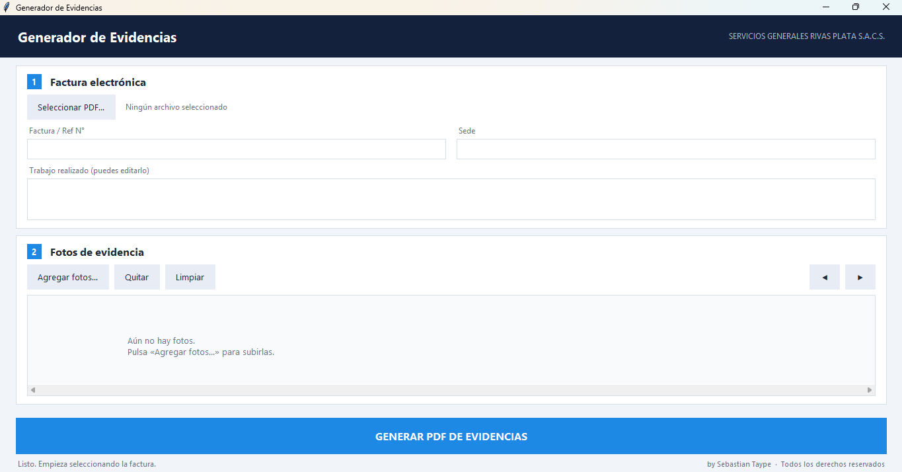
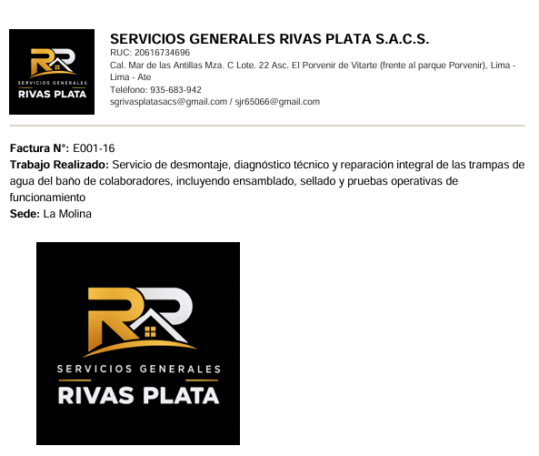

# 📄 Generador Automático de Evidencias Fotográficas (SUNAT PDF)

Aplicación de escritorio desarrollada en **Python** con interfaz gráfica (**Tkinter**) que automatiza la generación de informes de evidencias fotográficas en formato PDF A4 a partir de comprobantes electrónicos de SUNAT.

## 📸 Vistas de la Aplicación
| Interfaz Gráfica | PDF Generado |
| :---: | :---: |
|  |  |

---

## 🎯 Problema que resuelve
En operaciones de servicios generales y mantenimiento corporativo, cada factura emitida requiere un informe visual que sustente los trabajos realizados. Hacer este proceso manualmente en Word o editores de PDF toma tiempo y es propenso a errores de digitación. 

Esta herramienta reduce ese flujo a segundos: **extrae automáticamente los datos clave de la factura PDF** y maqueta las fotografías con el membrete corporativo listo para enviar al cliente.

---

## ✨ Características principales
* **Extracción inteligente (Regex + PyPDF):** Lee facturas electrónicas de SUNAT y extrae automáticamente el número de serie/correlativo (`E001-XX`), la descripción completa del servicio y la sede.
* **Gestor visual de fotografías:**
  * Carga múltiple de imágenes (`JPG`, `JPEG`, `PNG`) con vista previa en miniaturas.
  * Corrección automática de orientación EXIF (evita fotos rotadas tomadas desde celular).
  * Reordenamiento dinámico (`◀` / `▶`) y eliminación individual de imágenes.
* **Generación de PDF optimizado (`ReportLab`):**
  * Maquetación A4 con encabezado corporativo, logo opcional (`logo.png`) y datos del servicio.
  * Compresión y redimensionamiento automático de imágenes para generar archivos ligeros sin perder nitidez.
  * Paginación automática (2 fotografías por página con numeración al pie).

---

## 🛠️ Tecnologías utilizadas
* **Lenguaje:** Python 3.10+
* **Interfaz Gráfica:** `Tkinter`
* **Procesamiento de PDF:** `pypdf`, `ReportLab`
* **Procesamiento de Imágenes:** `Pillow (PIL)`
* **Extracción de texto:** Expresiones Regulares (`re`)

---

## 🚀 Instalación y Uso

1. **Clona este repositorio:**
   ```bash
   git clone [https://github.com/TU-USUARIO/generador-evidencias-factura.git](https://github.com/TU-USUARIO/generador-evidencias-factura.git)
   cd generador-evidencias-factura