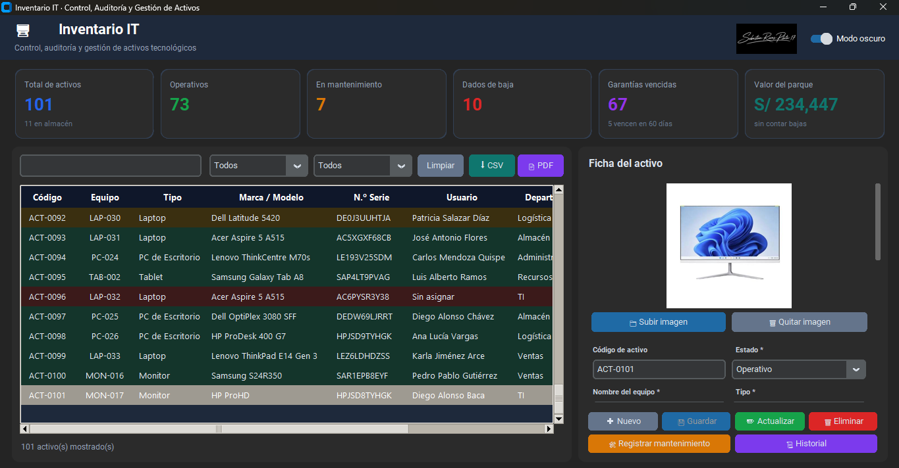
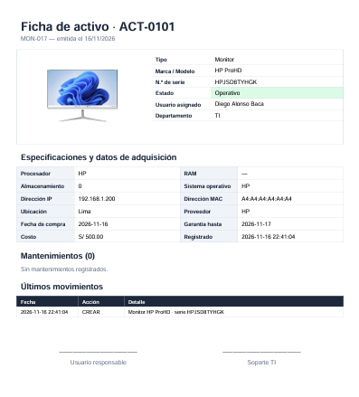
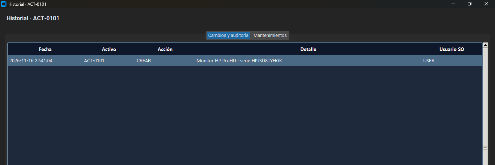

# 🖥️ Inventario IT Desktop

Sistema de **Control, Auditoría e Inventario de Equipos (IT Asset Management)** de escritorio, desarrollado en Python. Permite gestionar el parque informático de una organización: registrar equipos con su fotografía, controlar su estado y garantía, llevar su historial de cambios y mantenimientos, y generar reportes en PDF.



## ✨ Características

- **CRUD completo** de activos (crear, consultar, actualizar y eliminar) con validación de datos.
- **Imagen por dispositivo**: se adjunta, previsualiza, cambia o elimina desde la ficha.
- **Búsqueda en vivo** y filtros por tipo y estado; orden por columna.
- **Panel de indicadores**: total de activos, operativos, en mantenimiento, dados de baja, garantías vencidas y valor del parque.
- **Auditoría automática**: cada alta, modificación (valor anterior → nuevo), baja y mantenimiento queda registrado.
- **Bitácora de mantenimientos** preventivos, correctivos y predictivos, con cambio automático de estado del equipo.
- **Reportes PDF**: inventario general, garantías vencidas / por vencer y ficha individual con firmas.
- **Exportación a CSV** respetando los filtros activos.
- **Modo claro / oscuro**.
- **100 equipos de ejemplo** cargados en el primer arranque para probar el sistema de inmediato.

## 🧰 Tecnologías

Python 3.10+ · CustomTkinter · SQLite · Pillow · ReportLab

## 🗂️ Estructura

```
Inventario-IT-Desktop/
├── assets/            # Imágenes de la interfaz, capturas y fotos de equipos
├── database/          # Base de datos SQLite (se crea automáticamente)
├── src/
│   ├── main.py        # Interfaz gráfica
│   ├── database.py    # Acceso a datos y reglas de negocio
│   └── reportes.py    # Generador de reportes PDF
├── requirements.txt
└── README.md
```

## 🚀 Instalación y uso

```bash
git clone https://github.com/<tu-usuario>/Inventario-IT-Desktop.git
cd Inventario-IT-Desktop
python -m venv .venv
.venv\Scripts\activate          # En Linux/macOS: source .venv/bin/activate
pip install -r requirements.txt
python src/main.py
```

La primera vez se crea `database/inventario.db` con 100 equipos de ejemplo. Para reiniciar los datos, elimina ese archivo y vuelve a abrir la aplicación.

## 🗃️ Modelo de datos

| Tabla | Propósito |
|---|---|
| `equipos` | Inventario: código, tipo, marca, modelo, serie, hardware, red (IP/MAC), usuario, ubicación, estado, compra, garantía, costo, proveedor, observaciones e imagen |
| `historial` | Auditoría de acciones (CREAR, ACTUALIZAR, ELIMINAR, MANTENIMIENTO) con fecha y usuario del sistema |
| `mantenimientos` | Bitácora de mantenimientos por equipo (fecha, tipo, descripción, técnico, costo, estado) |

## 📸 Capturas

### Ficha del activo con imagen


### Historial de auditoría y mantenimientos


## 🛣️ Próximas mejoras

- Lectura de códigos QR / código de barras para localizar equipos.
- Importación masiva desde Excel.
- Alertas por correo de garantías próximas a vencer.
- Gestión de usuarios y roles.

## 👤 Autor

**Sebastian Jhonnel Taype Rivas Plata** — Estudiante de Ingeniería de Sistemas, UCSS.
[LinkedIn](https://linkedin.com/in/sebastian-jhonnel-taype-rivas-plata-3a375b434)